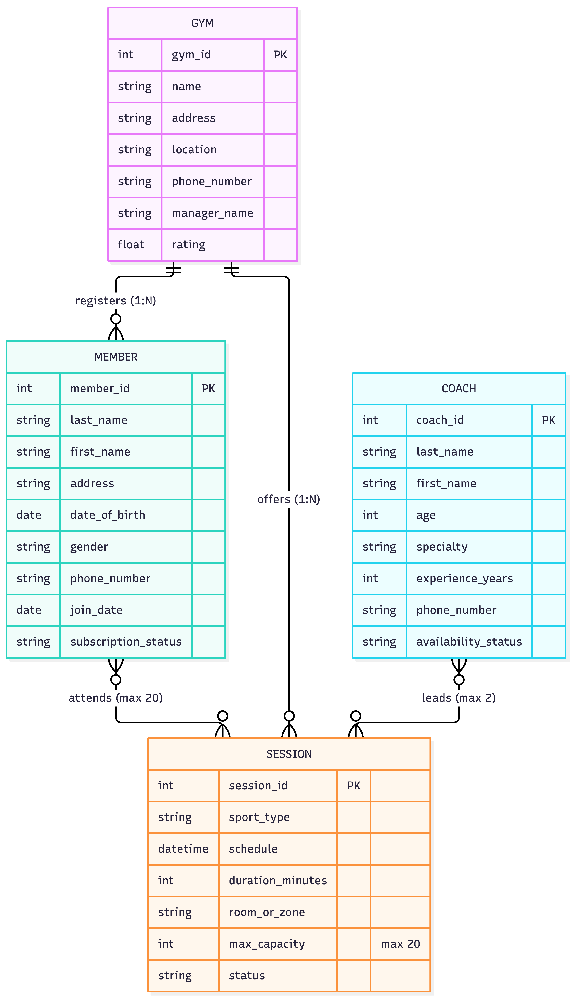

# Entity-Relationship Model - Gym Chain

This repo contains my ER model for the gym chain checkpoint (Relational Databases course).

The gym owner still uses paper cards to manage members, and an employee put a member in the wrong session. The idea is to design a database that keeps track of the gyms, the members, the sessions and the coaches, so this kind of mistake doesn't happen again.

## Diagram

## Entities

**Gym**
- gym_id (primary key)
- name
- address
- location
- phone_number
- manager_name
- rating

**Member**
- member_id (primary key)
- last_name
- first_name
- address
- date_of_birth
- gender
- phone_number
- join_date
- subscription_status

**Coach**
- coach_id (primary key)
- last_name
- first_name
- age
- specialty
- experience_years
- phone_number
- availability_status

**Session**
- session_id (primary key)
- sport_type
- schedule
- duration_minutes
- room_or_zone
- max_capacity (20 max)
- status

The brief asked for the gym's name, address and phone number. For members it asked for an id, last name, first name, address, date of birth and gender. Sessions need a sport type and a schedule, and coaches need a last name, first name, age and specialty. I added a few more fields (rating, join_date, experience_years, etc.) that seemed useful for a real gym.

## Relationships

- **Gym - Member (registers)**: one to many. A member registers at one gym only, and a gym can have many members.
- **Gym - Session (offers)**: one to many. Each session takes place in one gym.
- **Member - Session (attends)**: many to many. A member can sign up for several sessions, and a session can have up to 20 members.
- **Coach - Session (leads)**: many to many. A coach can lead several sessions, but a session has at most 2 coaches.

The limits of 20 members and 2 coaches can't really be shown in the diagram, so they have to be checked by the database (with a CHECK constraint or a trigger) or by the application.

## Tables

The two many-to-many relationships become their own tables:

- GYM (gym_id, name, address, location, phone_number, manager_name, rating)
- MEMBER (member_id, last_name, first_name, address, date_of_birth, gender, phone_number, join_date, subscription_status, gym_id)
- COACH (coach_id, last_name, first_name, age, specialty, experience_years, phone_number, availability_status)
- SESSION (session_id, sport_type, schedule, duration_minutes, room_or_zone, max_capacity, status, gym_id)
- ATTENDS (member_id, session_id)
- LEADS (coach_id, session_id)

## How this fixes the problem

Every registration is saved in the ATTENDS table, so the receptionist can check right away whether a member is signed up for a session. That would have avoided the argument at the front desk. The capacity limit also stops a session from going over 20 people.

The diagram was made with Mermaid.
